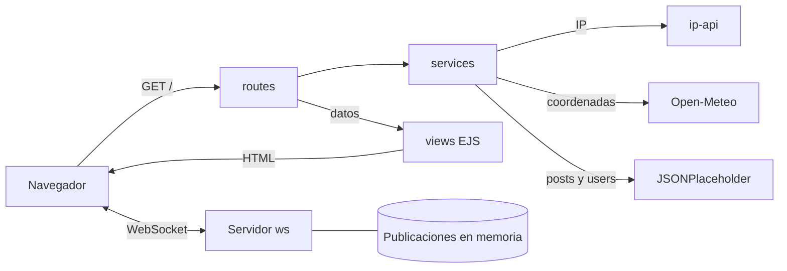

<p align="center">
  
</p>

<h1 align="center">SkySocial</h1>

<p align="center">
  Red social en tiempo real que une el clima de tu ubicación, el feed de la comunidad y un chat global.
</p>

<p align="center">
  
  
  
  
  
  
  
</p>

---

## Descripción

**SkySocial** es una plataforma web que simula una red social con integración meteorológica y comunicación en tiempo real. Al abrirla, detecta la ubicación aproximada del visitante a partir de su IP, muestra el clima actual de esa zona, presenta las publicaciones de la comunidad y permite publicar mensajes que llegan al instante a todas las personas conectadas.

Es el primer proyecto del curso **Programación en Ambiente Web II (ISW-621)** de la carrera de Ingeniería del Software en la Universidad Técnica Nacional, Sede San Carlos. Su objetivo es aplicar en un mismo producto el desarrollo del lado del servidor con TypeScript, el consumo asíncrono de APIs externas, el renderizado con plantillas y la comunicación bidireccional con WebSockets.

---

## Funcionalidades

| Módulo | Qué hace |
| --- | --- |
| **Clima** | Detecta la ubicación aproximada del usuario por su IP y consulta la temperatura y la velocidad del viento actuales para esas coordenadas. |
| **Feed social** | Muestra las publicaciones de la comunidad, combinando el título y el contenido de cada post con el nombre de su autor. |
| **Chat global** | Permite publicar con un nombre y un texto. El servidor asigna un identificador único y la hora, y lo transmite en tiempo real a todos los clientes conectados. Quien se conecta después recibe el historial de la sesión. |
| **Tolerancia a fallos** | Si una API externa no responde, la aplicación no se detiene: el módulo afectado muestra un mensaje claro y el resto sigue funcionando. |

### Experiencia de usuario

- Navegación entre los tres módulos sin recargar la página, con barra inferior tipo app en móvil.
- Modo claro y oscuro con transición circular; la preferencia se recuerda en el navegador.
- Diseño adaptable verificado desde 320 px hasta 1920 px, en vertical y horizontal.
- Ilustración del clima en 3D hecha solo con CSS, con parallax por capas y ráfagas de viento que se mueven según la velocidad real.
- Accesibilidad: etiquetas para lectores de pantalla, foco visible y contenido que se lee aunque falle JavaScript.

---

## Tecnologías

| Tecnología | Uso en el proyecto |
| --- | --- |
| **TypeScript** | Todo el código, tanto del servidor como del navegador, con tipado estricto. |
| **Node.js + Express 5** | Servidor HTTP, rutas y archivos estáticos. |
| **EJS** | Vistas renderizadas en el servidor, divididas en parciales por módulo. |
| **ws** | Servidor WebSocket que comparte el puerto con Express. |
| **Axios** | Consumo de las APIs externas con `async/await`. |
| **dotenv** | Configuración mediante variables de entorno. |
| **tsx** y **concurrently** | Desarrollo con recarga automática del servidor y compilación del cliente en paralelo. |
| **CSS** | Diseño propio con tokens, glassmorphism, animaciones y modo oscuro, sin frameworks. |

### APIs externas

| API | Propósito |
| --- | --- |
| [ip-api](https://ip-api.com/) | Ubicación aproximada (ciudad, región y coordenadas) a partir de la IP. |
| [Open-Meteo](https://open-meteo.com/) | Temperatura y velocidad del viento actuales según coordenadas. |
| [JSONPlaceholder](https://jsonplaceholder.typicode.com/) | Publicaciones (`/posts`) y usuarios (`/users`) que simulan la comunidad. |

---

## Arquitectura

```
Proyecto1-SkySocial
 ┣ 📂 src
 ┃ ┣ 📂 services        Lógica de llamadas a las APIs externas
 ┃ ┣ 📂 routes          Definición de los endpoints de Express
 ┃ ┣ 📂 types           Interfaces que modelan los datos (Post, User y demás)
 ┃ ┣ 📂 client          Código TypeScript que se ejecuta en el navegador
 ┃ ┗ 📄 server.ts       Arranque de Express y del servidor HTTP
 ┣ 📂 views
 ┃ ┣ 📂 partials        head, header, weather, feed, chat, footer y recursos compartidos
 ┃ ┗ 📄 index.ejs       Página principal que compone los parciales
 ┣ 📂 public
 ┃ ┣ 📂 css             tokens.css, main.css y animations.css
 ┃ ┣ 📂 js              Cliente compilado desde src/client (se genera al compilar)
 ┃ ┗ 📂 assets          Fuentes locales e imágenes
 ┣ 📂 docs              Manual de usuario y capturas
 ┣ 📄 tsconfig.json         Compilación del servidor (Node)
 ┗ 📄 tsconfig.client.json  Compilación del cliente (navegador)
```

### Flujo de datos



### Decisiones técnicas

- **Separación de responsabilidades:** los servicios solo hablan con las APIs, las rutas coordinan y las vistas solo muestran. Ninguna plantilla llama a una API.
- **Sin base de datos:** las publicaciones en vivo se guardan en memoria con estructuras de TypeScript. Es un almacenamiento volátil por diseño: se reinicia junto con el servidor.
- **Un solo puerto:** Express y el WebSocket comparten el mismo servidor HTTP de Node.
- **Dos configuraciones de TypeScript:** el servidor compila para Node y el cliente para el navegador, con la librería `DOM`. Así el compilador avisa si se usa una API que no existe en el entorno.
- **Fallos aislados:** cada API se consulta por separado y con su propio manejo de errores, para que la caída de una no afecte a las demás.
- **Seguridad:** el contenido dinámico se imprime escapado en EJS y se inserta con `textContent` en el navegador, lo que evita la inyección de HTML.
- **Rendimiento:** fuentes variables alojadas localmente, ilustraciones hechas con CSS en lugar de imágenes y versión en los recursos estáticos para evitar cachés desactualizadas.

---

## Ejecución

Requiere **Node.js 20 o superior** y conexión a internet para consultar las APIs.

```bash
npm install
```

Copiar las variables de entorno de ejemplo:

```bash
cp .env.example .env
```

| Variable | Descripción | Valor por defecto |
| --- | --- | --- |
| `PORT` | Puerto del servidor | `3000` |
| `DEFAULT_LAT` / `DEFAULT_LON` | Coordenadas de respaldo si no se puede detectar la ubicación | San Carlos, Costa Rica |
| `DEFAULT_CITY` | Ciudad de respaldo | `San Carlos` |

Modo desarrollo, con recarga automática:

```bash
npm run dev
```

Compilar y ejecutar en producción:

```bash
npm run build
npm start
```

La aplicación queda disponible en `http://localhost:3000`.

| Script | Acción |
| --- | --- |
| `npm run dev` | Servidor con recarga y compilación del cliente en paralelo |
| `npm run build` | Compila el servidor en `dist/` y el cliente en `public/js/` |
| `npm start` | Ejecuta la versión compilada |
| `npm run typecheck` | Verifica los tipos del servidor y del cliente sin generar archivos |

---

## Estado del proyecto

```
🟡 En desarrollo
```

- [x] Arquitectura, configuración de TypeScript y servidor Express
- [x] Diseño de la interfaz, modo oscuro y adaptación a todos los tamaños
- [ ] Tipos y servicios de las APIs externas
- [ ] Ruta principal con manejo de errores
- [ ] Publicaciones en tiempo real con WebSockets
- [ ] Manual de usuario y capturas

---

## Autor

**Wilberth Guillén Aguilar**
Estudiante de Ingeniería del Software, UTN Sede San Carlos
[@WGuillenDev](https://github.com/WGuillenDev)
