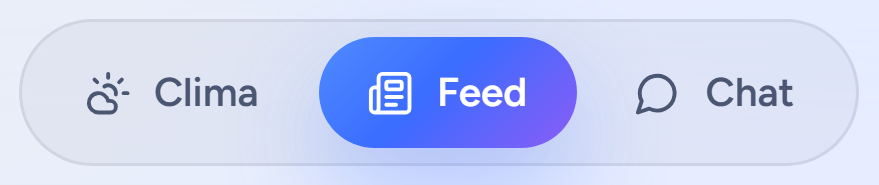
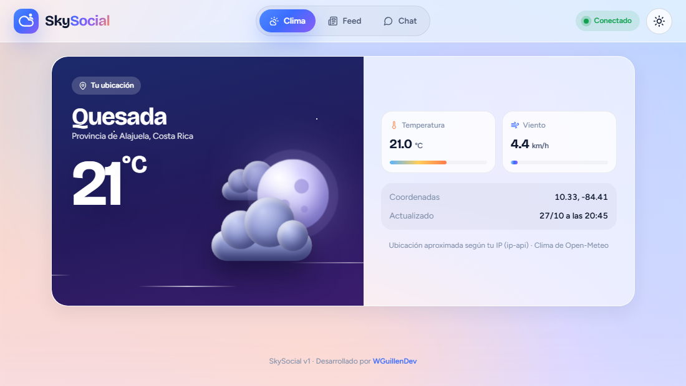
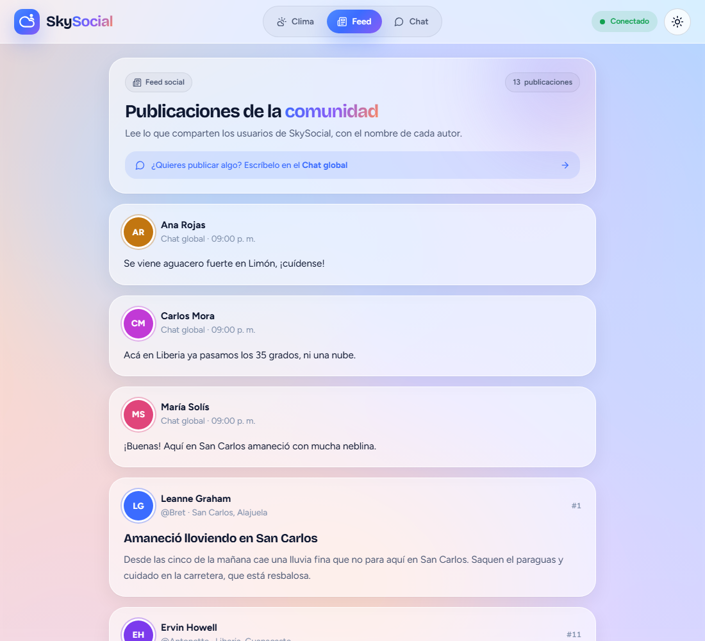
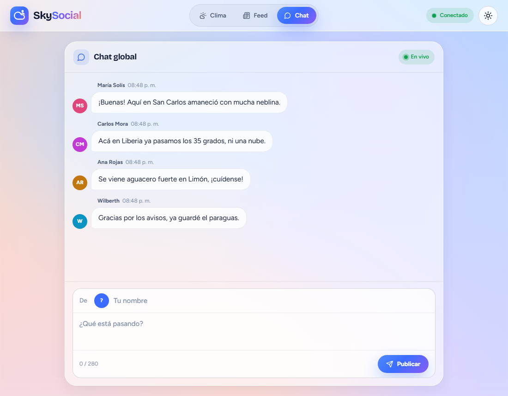
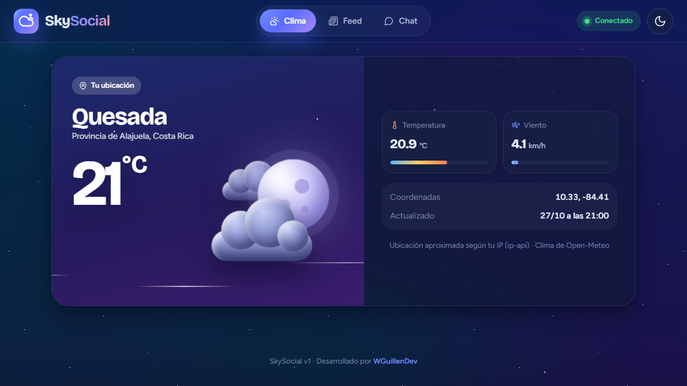
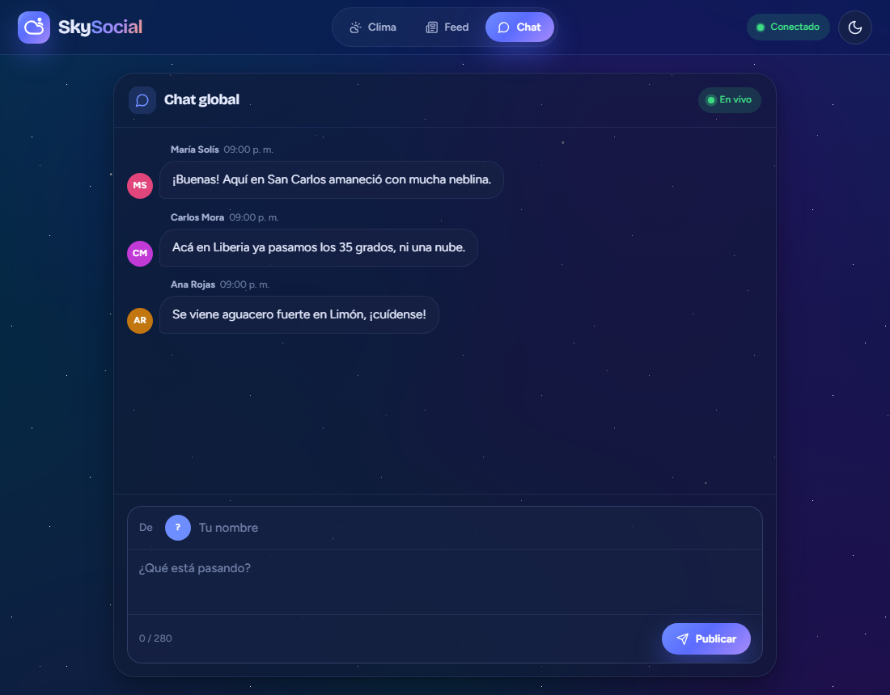
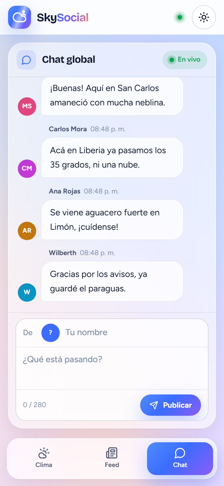
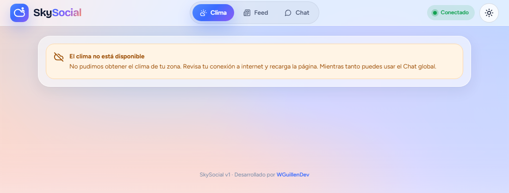
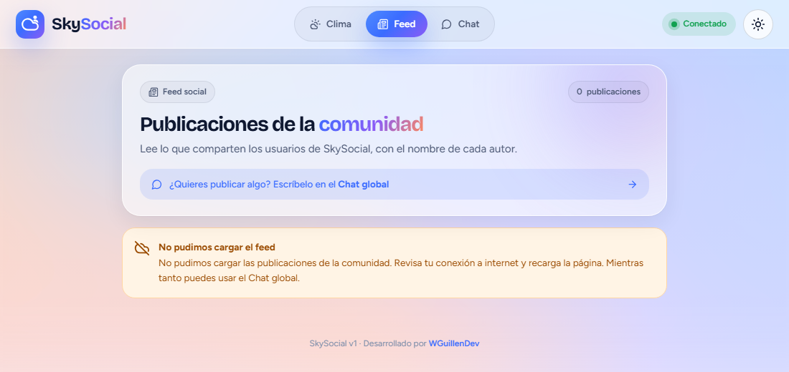

<p align="center">
  
</p>

<h1 align="center">Manual de usuario</h1>

<p align="center">
  Guía para usar SkySocial: el clima de tu zona, el feed de la comunidad y el chat global en tiempo real.
</p>

<p align="center">
  
  
  
</p>

---

## Contenido

1. [Introducción](#1-introducción)
2. [Requisitos](#2-requisitos)
3. [Instalación y arranque](#3-instalación-y-arranque)
4. [Navegación](#4-navegación)
5. [Módulo Clima](#5-módulo-clima)
6. [Módulo Feed](#6-módulo-feed)
7. [Módulo Chat global](#7-módulo-chat-global)
8. [Tema claro y oscuro](#8-tema-claro-y-oscuro)
9. [Uso en el celular](#9-uso-en-el-celular)
10. [Cuando algo falla](#10-cuando-algo-falla)
11. [Configuración avanzada](#11-configuración-avanzada)
12. [Preguntas frecuentes](#12-preguntas-frecuentes)

---

## 1. Introducción

**SkySocial** es una red social que reúne tres cosas en una sola página:

| Módulo | Para qué sirve |
| --- | --- |
| **Clima** | Ver la temperatura y el viento actuales del lugar donde estás. |
| **Feed** | Leer las publicaciones de la comunidad sobre el clima de cada zona de Costa Rica. |
| **Chat global** | Escribir un mensaje que todas las personas conectadas ven al instante. |

No necesitas crear una cuenta: basta con escribir un nombre al publicar.

---

## 2. Requisitos

| Requisito | Detalle |
| --- | --- |
| Navegador | Chrome, Edge, Firefox o Safari en una versión reciente. |
| Conexión | Internet, para consultar la ubicación, el clima y las publicaciones. |
| Para ejecutar la aplicación | Node.js 20 o superior. |

---

## 3. Instalación y arranque

Esta parte es para quien ejecuta la aplicación en su computadora.

1. Abrir una terminal en la carpeta del proyecto e instalar las dependencias:

   ```bash
   npm install
   ```

2. Crear el archivo de configuración a partir del ejemplo:

   ```bash
   cp .env.example .env
   ```

3. Iniciar el servidor:

   ```bash
   npm run dev
   ```

4. Abrir **http://localhost:3000** en el navegador.

> **Consejo:** para ver el chat en tiempo real, abre la misma dirección en dos pestañas o en dos navegadores y publica desde una de ellas.

---

## 4. Navegación

La página tiene tres zonas:

| Zona | Qué contiene |
| --- | --- |
| **Barra superior** | El logo, la navegación entre módulos, el indicador de conexión y el botón de tema. |
| **Contenido** | El módulo elegido: Clima, Feed o Chat. |
| **Pie de página** | La versión de la aplicación y el autor. |

### Menú de módulos

<p align="center">
  <br>
  <sub><strong>Navegación:</strong> píldoras Clima, Feed y Chat de la barra superior</sub>
</p>

Las píldoras **Clima**, **Feed** y **Chat** cambian de módulo sin recargar la página. La activa lleva un indicador de color que se desliza. La dirección del navegador cambia a `#clima`, `#feed` o `#chat`, de modo que puedes guardar el enlace directo a un módulo. Si abres la página sin indicar ninguno, se muestra el Feed.

### Indicador de conexión

| Estado | Significado |
| --- | --- |
| Naranja, **Conectando…** | La página está abriendo la conexión con el chat. |
| Verde, **Conectado** | El chat está listo para enviar y recibir mensajes. |
| Rojo, **Desconectado** | Se perdió la conexión con el servidor. La página lo reintenta sola cada tres segundos. |

---

## 5. Módulo Clima

<p align="center">
  
</p>

Muestra el clima actual del lugar donde te encuentras:

| Dato | Descripción |
| --- | --- |
| **Ubicación** | Ciudad, región y país, detectados de forma aproximada a partir de tu dirección IP. |
| **Temperatura** | En grados Celsius, con una barra que va de frío a calor. |
| **Viento** | Velocidad en km/h. Las ráfagas de la ilustración se mueven más rápido cuanto más viento hay. |
| **Coordenadas** | Latitud y longitud usadas para consultar el clima. |
| **Actualizado** | Fecha y hora de la medición, en la hora local del lugar. |

La ilustración cambia con la hora real de la zona: sol de día, y luna con estrellas de noche.

> **Nota:** la ubicación por IP es aproximada. Si la aplicación se ejecuta en la misma computadora donde la abres, se usa la ubicación de tu conexión a internet. Si no se puede detectar, se muestra el clima de **San Carlos, Costa Rica**.

---

## 6. Módulo Feed

<p align="center">
  
</p>

El feed muestra las publicaciones de la comunidad. Arriba aparecen las que se escriben en el Chat global, de la más reciente a la más antigua; debajo, las publicaciones de la comunidad.

| Tipo | Qué muestra |
| --- | --- |
| **Del chat** | Avatar con las iniciales, nombre, "Chat global" con la hora y el texto. Aparece al instante, sin recargar. |
| **De la comunidad** | Avatar, nombre del autor, su usuario y su zona de Costa Rica, el número de la publicación, el título y el contenido. |

El contador de la parte superior suma ambos tipos de publicaciones. Para publicar, usa el enlace **"¿Quieres publicar algo? Escríbelo en el Chat global"**, que te lleva directamente al chat.

---

## 7. Módulo Chat global

<p align="center">
  
</p>

### Publicar un mensaje

1. En la fila **De**, escribe tu nombre (máximo 40 caracteres). El avatar muestra tus iniciales mientras escribes.
2. En **¿Qué está pasando?**, escribe tu mensaje (máximo 280 caracteres). El contador inferior se pone naranja cuando te acercas al límite.
3. Presiona **Publicar** o la tecla **Enter**. Para hacer un salto de línea usa **Shift + Enter**.

El mensaje aparece al instante en la pantalla de todas las personas conectadas, con tu nombre, tu avatar y la hora de publicación, tanto en el chat como arriba del Feed. Después de publicar, el texto se borra y tu nombre se conserva para el siguiente mensaje; la página lo recuerda también en tus próximas visitas.

### Cómo se ven los mensajes

| Mensaje | Aspecto |
| --- | --- |
| **Tuyo** | A la derecha, con burbuja de color azul y violeta. |
| **De otra persona** | A la izquierda, con su avatar y una burbuja translúcida. |
| **Aviso del sistema** | Píldora centrada, por ejemplo cuando no hay conexión. |

### Historial

Al entrar o recargar la página, el chat muestra los mensajes publicados desde que se encendió el servidor. Se guardan en la memoria del servidor: si este se reinicia, el historial empieza de nuevo.

---

## 8. Tema claro y oscuro

El botón con el sol o la luna, a la derecha de la barra superior, cambia entre ambos temas con una transición circular. La preferencia se guarda en el navegador. Si nunca has elegido uno, la página usa el tema de tu sistema operativo.

En el tema oscuro, el fondo se convierte en un cielo nocturno con estrellas que titilan y los paneles de vidrio se oscurecen. Así se ven los tres módulos:

### Clima

<p align="center">
  
</p>

### Feed

<p align="center">
  
</p>

### Chat global

<p align="center">
  
</p>

---

## 9. Uso en el celular

<p align="center">
  
</p>

La aplicación se adapta a pantallas desde 320 px de ancho:

- La navegación pasa a una **barra fija en la parte inferior**, con un ícono y el nombre de cada módulo.
- El chat ocupa toda la altura disponible y el formulario queda visible al escribir.
- El indicador de conexión se reduce a un punto de color.

---

## 10. Cuando algo falla

SkySocial no se detiene aunque un servicio externo no responda. Cada módulo afectado (Clima o Feed) muestra un aviso con lo que ocurrió y qué hacer, y el **Chat global** sigue funcionando porque no depende de esos servicios.

<p align="center">
  
</p>

<p align="center">
  
</p>

| Situación | Qué verás | Qué hacer |
| --- | --- | --- |
| No responde el servicio del clima | Aviso **"El clima no está disponible"** | Revisar la conexión a internet y recargar la página. El Chat global sigue disponible. |
| No se pudo detectar la ubicación | El clima de San Carlos, la ubicación de respaldo | Nada: es el comportamiento esperado. |
| No responde el servicio de publicaciones | Aviso **"No pudimos cargar el feed"** | Revisar la conexión a internet y recargar la página. El Chat global sigue disponible. |
| El indicador está en rojo | **Desconectado** y, al intentar publicar, el aviso *"No se pudo publicar: no hay conexión con el servidor"*. Tu texto se conserva. | Comprobar que el servidor siga encendido. La página se reconecta sola y el aviso desaparece cuando vuelve la conexión; entonces vuelve a presionar **Publicar**. |
| El botón **Publicar** no envía | Falta el nombre o el texto | Completar ambos campos. |

---

## 11. Configuración avanzada

Estas opciones se cambian en el archivo `.env` y requieren reiniciar el servidor.

| Variable | Descripción | Valor por defecto |
| --- | --- | --- |
| `PORT` | Puerto en el que se abre la aplicación. | `3000` |
| `DEFAULT_LAT` / `DEFAULT_LON` | Coordenadas de respaldo si no se puede detectar la ubicación. | San Carlos, Costa Rica |
| `DEFAULT_CITY` / `DEFAULT_REGION` / `DEFAULT_COUNTRY` | Ciudad, región y país de respaldo. | `San Carlos`, `Alajuela`, `Costa Rica` |
| `FEED_ORIGINAL` | Con `true`, el feed muestra el título y el contenido originales de JSONPlaceholder en lugar de la versión en español. | `false` |

---

## 12. Preguntas frecuentes

**¿Necesito una cuenta para publicar?**
No. Solo escribes un nombre cada vez que publicas; la página lo recuerda en tu navegador.

**¿Por qué el clima muestra una ciudad cercana y no la mía exacta?**
La ubicación se calcula a partir de la dirección IP de tu conexión, que es aproximada y puede corresponder a la central de tu proveedor de internet.

**¿Por qué mi mensaje desapareció después de un tiempo?**
Las publicaciones viven en la memoria del servidor. Si el servidor se reinicia, el historial se borra. El chat guarda como máximo los últimos 100 mensajes.

**¿Los demás ven mi nombre?**
Sí. El nombre que escribes se muestra junto a tu mensaje a todas las personas conectadas.

**¿Por qué los textos del feed están en español si vienen de una API?**
JSONPlaceholder entrega texto de relleno en pseudolatín. SkySocial usa de la API los autores y los números de publicación, y muestra el contenido en español sobre el clima. Con `FEED_ORIGINAL=true` se ven los textos originales de la API.

---

<p align="center">
  <strong>SkySocial v1</strong> · Desarrollado por <a href="https://github.com/WGuillenDev">WGuillenDev</a>
</p>
