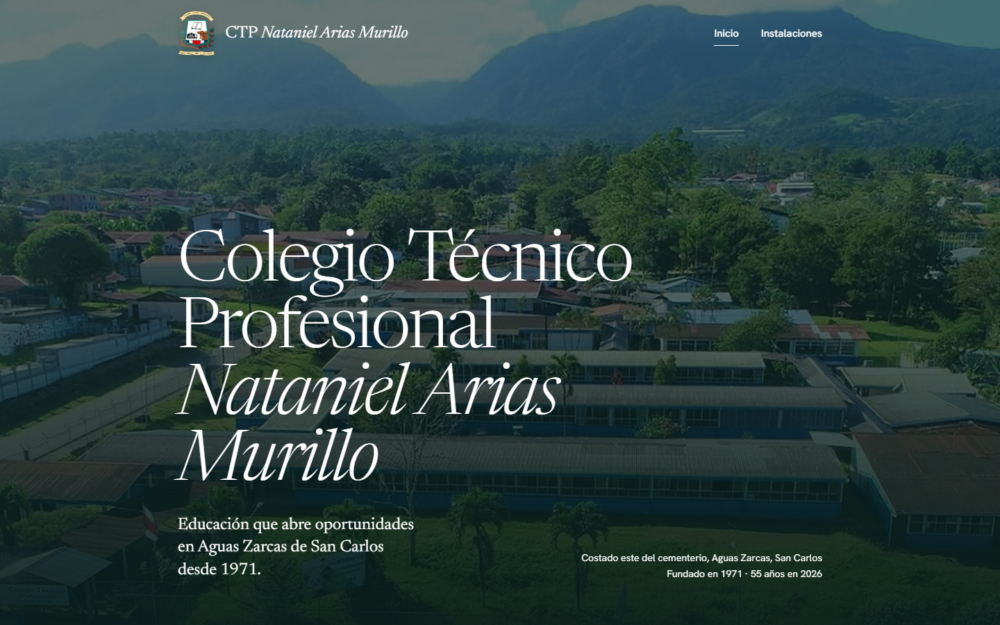
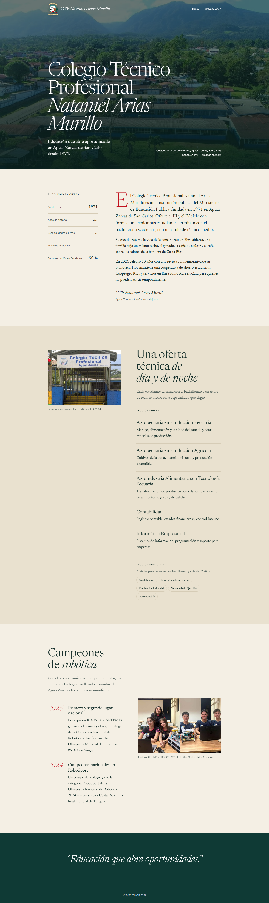
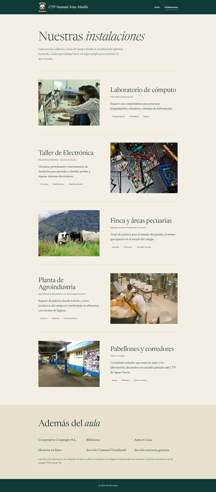
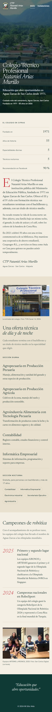
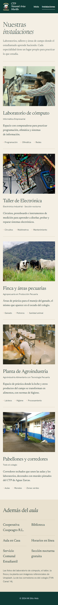

# Tarea Clase 8 | Sitio web del CTP Nataniel Arias Murillo

> Programación en Ambiente Web II (ISW-621) · Ingeniería del Software
> Universidad Técnica Nacional, Sede San Carlos

---

## Descripción

Aplicación web del **Colegio Técnico Profesional Nataniel Arias Murillo** (Aguas Zarcas, San Carlos) con dos páginas: **Inicio** e **Instalaciones**. Parte de la estructura base de la tarea y la amplía con las adaptaciones permitidas por la docente, combinando tres piezas del curso:

- **Express 5** como servidor HTTP.
- **EJS** como motor de plantillas, con **parciales** reutilizables (`header` y `footer`).
- **`Router` de Express** para separar las rutas del arranque de la aplicación.

El contenido (datos del colegio, especialidades, instalaciones) vive en arreglos dentro de las rutas y las vistas lo recorren con `forEach`. Todo valor dinámico se imprime con `<%= %>`, que escapa el HTML y evita inyecciones XSS.

---

## Tecnologías


---

## Arquitectura de archivos

La estructura parte de la propuesta en clase (`views/partials`, `routes/index.js` y `home.js`). Sobre ella se agregó la carpeta `public/` para los recursos estáticos, con el CSS separado de las vistas.

```
miApp
 ┣ 📄 home.js                    Punto de entrada: configura Express, EJS y monta el router
 ┣ 📄 package.json
 ┣ 📂 routes
 ┃ ┗ 📄 index.js                 Router con las rutas "/" e "/Instalaciones" y sus datos
 ┣ 📂 views
 ┃ ┣ 📂 partials
 ┃ ┃ ┣ 📄 header.ejs             <head>, h1 y menú de navegación
 ┃ ┃ ┗ 📄 footer.ejs             Pie de página y carga del script
 ┃ ┣ 📄 index.ejs                Página de inicio
 ┃ ┗ 📄 instalaciones.ejs        Página de instalaciones
 ┗ 📂 public                     Recursos estáticos (express.static)
   ┣ 📂 css
   ┃ ┣ 📄 tokens.css             Variables de diseño (colores, tipografía, espaciado)
   ┃ ┣ 📄 main.css               Estilos de layout y componentes
   ┃ ┗ 📄 animations.css         Animaciones y transiciones
   ┣ 📂 js
   ┃ ┗ 📄 interaccion.js         Header al hacer scroll, aparición de bloques y conteo de cifras
   ┗ 📂 assets
     ┣ 📂 fonts                  Newsreader y Hanken Grotesk (autoalojadas, WOFF2)
     ┗ 📂 images                 Imágenes institucionales e instalaciones (WebP)
```

### Responsabilidad de cada capa

| Capa | Archivo | Responsabilidad |
| --- | --- | --- |
| Arranque | `home.js` | Define el puerto, el directorio de vistas, el motor EJS, los archivos estáticos, el router y la respuesta 404. |
| Rutas | `routes/index.js` | Declara las rutas con `Router()`, prepara los datos y renderiza cada vista. |
| Vistas | `views/*.ejs` | Maquetan el contenido con los datos recibidos, sin lógica de negocio. |
| Parciales | `views/partials/*.ejs` | Encabezado y pie compartidos por ambas páginas mediante `include`. |
| Estáticos | `public/` | CSS, JavaScript del cliente, fuentes e imágenes. |

---

## Rutas

| Método | Ruta | Vista | Descripción |
| --- | --- | --- | --- |
| GET | `/` | `index.ejs` | Presentación del colegio, especialidades, robótica y lema. |
| GET | `/Instalaciones` | `instalaciones.ejs` | Lista de 5 instalaciones y servicios del colegio. |
| GET | cualquier otra | — | Respuesta 404 con el mensaje "Página no encontrada". |

---

## Capturas

### Inicio



Página completa:



### Instalaciones



### Versión móvil

El diseño es responsivo y se adapta a pantallas de celular.

| Inicio | Instalaciones |
| --- | --- |
|  |  |

---

## Buenas prácticas aplicadas

- **Separación de responsabilidades:** arranque, rutas, vistas y recursos estáticos en carpetas distintas.
- **Seguridad:** salida escapada con `<%= %>`; `<%- %>` solo se usa para incluir parciales.
- **ES Modules** (`"type": "module"`) y `Router` modular listo para crecer con más rutas.
- **CSS organizado** en tokens, estilos base y animaciones, sin estilos en línea.
- **Accesibilidad:** `lang="es"`, `alt` descriptivo en cada imagen, `aria-current` en el enlace activo y respeto de `prefers-reduced-motion`.
- **Rendimiento:** imágenes WebP con `srcset`, carga diferida (`loading="lazy"`) y fuentes autoalojadas.

---

## Ejecución

Requiere Node.js 20 o superior.

```bash
cd miApp
npm install
npm start
```

El sitio queda disponible en `http://localhost:3000`. Para desarrollo con recarga automática: `npm run dev`.

---

## Créditos

- **Imágenes institucionales:** Facebook oficial del CTP (vista aérea), TVN Canal 14 (entrada y corredores), San Carlos Digital (equipos de robótica) y escudo oficial del colegio.
- **Imágenes de instalaciones:** fotografías referenciales de Unsplash, rotuladas como tales en el sitio.
- **Tipografías:** [Newsreader](https://fonts.google.com/specimen/Newsreader) y [Hanken Grotesk](https://fonts.google.com/specimen/Hanken+Grotesk), bajo licencia SIL Open Font License (incluida en `public/assets/fonts/`).

---

## Autor

**Wilberth Guillén Aguilar**
Estudiante de Ingeniería del Software, UTN Sede San Carlos
[@WGuillenDev](https://github.com/WGuillenDev)
