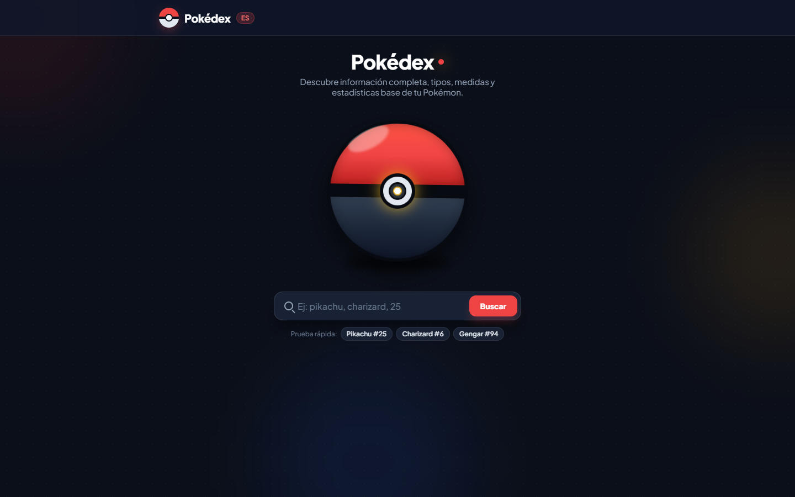
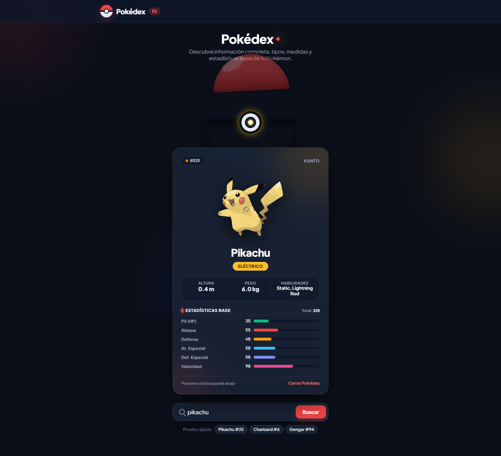
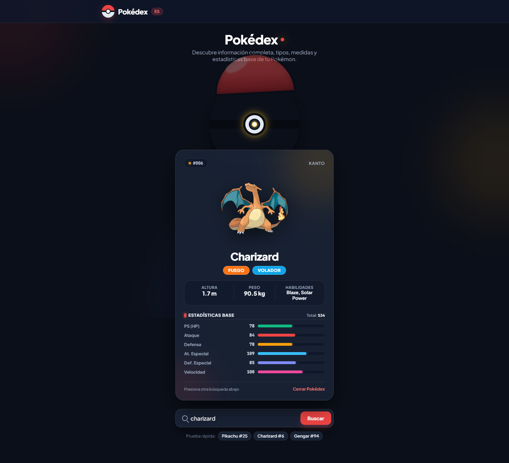
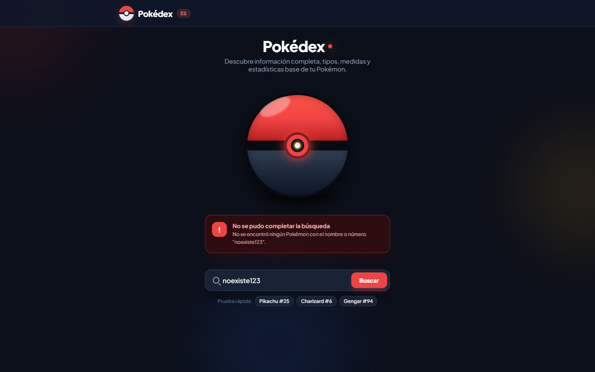
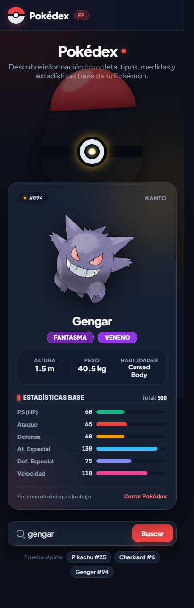

# Pokédex | Buscador de Pokémon

> Programación en Ambiente Web II (ISW-621) · Clase 9 · Práctica de consumo de APIs
> Universidad Técnica Nacional, Sede San Carlos

---

## Descripción

Aplicación web que consulta la **[PokéAPI](https://pokeapi.co/)** desde el servidor y muestra la ficha de cualquier Pokémon en español: número, región, tipos, medidas, habilidades y estadísticas base con barras de progreso.

La búsqueda acepta el **nombre** o el **número** del Pokémon (por ejemplo `pikachu`, `charizard` o `25`). Incluye tres accesos rápidos y manejo de errores para búsquedas vacías, Pokémon inexistentes y fallos de conexión.

**Flujo de la aplicación**

1. El usuario envía el formulario por `POST /pokemon`.
2. El servidor consulta la PokéAPI con Axios.
3. La respuesta se transforma a un modelo de vista (traducción de tipos, región, unidades y porcentajes).
4. EJS renderiza la tarjeta con los datos ya preparados.

---

## Tecnologías


| Tecnología | Uso en el proyecto |
| --- | --- |
| **TypeScript** | Tipado de la respuesta de la API y del modelo de vista. |
| **Express 5** | Servidor HTTP, rutas `GET /` y `POST /pokemon`, archivos estáticos. |
| **EJS** | Motor de plantillas para renderizar la tarjeta del Pokémon. |
| **Axios** | Cliente HTTP para consultar la PokéAPI. |
| **dotenv** | Configuración del puerto mediante variables de entorno. |
| **tsx** | Ejecución de TypeScript en desarrollo con recarga automática. |
| **CSS** | Diseño propio con variables, animaciones y adaptación a móvil. |

---

## Arquitectura de archivos

```
PracticaClase
 ┣ 📂 src
 ┃ ┗ 📄 app.ts                   Servidor, rutas, tipos y transformación de datos
 ┣ 📂 views
 ┃ ┗ 📄 index.ejs                Vista única con los estados: inicial, resultado y error
 ┣ 📂 public
 ┃ ┗ 📂 css
 ┃   ┣ 📄 tokens.css             Variables de diseño (colores, tipografía, radios)
 ┃   ┣ 📄 main.css               Estilos de layout y componentes
 ┃   ┗ 📄 animations.css         Animaciones de la Pokébola y la tarjeta
 ┣ 📄 package.json
 ┣ 📄 tsconfig.json
 ┗ 📄 .env                       Puerto (no se versiona)
```

### Decisiones de diseño

- **Modelo de vista:** la función `aVista()` convierte la respuesta cruda de la API en un objeto listo para mostrar, de modo que la plantilla solo recorre datos y no contiene lógica.
- **Datos en español:** los tipos y las estadísticas se traducen con diccionarios (`TIPOS`, `ESTADISTICAS`) y la región se calcula según el número de la Pokédex.
- **Un solo estado en la vista:** `index.ejs` calcula si está en estado `idle`, `result` o `error` y el CSS ajusta la animación de la Pokébola según ese estado.
- **Seguridad:** todo valor dinámico se imprime con `<%= %>` (escapado) y el nombre buscado se codifica con `encodeURIComponent` antes de armar la URL.

---

## Capturas

### Pantalla inicial



### Resultado de búsqueda

| Pikachu | Charizard |
| --- | --- |
|  |  |

### Manejo de errores

Búsqueda de un Pokémon que no existe:



### Versión móvil



---

## Ejecución

Requiere Node.js 20 o superior y conexión a internet para consultar la PokéAPI.

```bash
npm install
```

Crear un archivo `.env` con el puerto:

```
PORT=3000
```

Modo desarrollo (recarga automática):

```bash
npm run dev
```

Compilar y ejecutar en producción:

```bash
npm run build
npm start
```

La aplicación queda disponible en `http://localhost:3000`.

---

## Créditos

- Datos e imágenes oficiales: [PokéAPI](https://pokeapi.co/).
- Tipografías: Plus Jakarta Sans y JetBrains Mono, servidas desde Google Fonts.
- Pokémon y sus nombres son marcas de Nintendo, Game Freak y The Pokémon Company; este proyecto tiene fines académicos.

---

## Autor

**Wilberth Guillén Aguilar**
Estudiante de Ingeniería del Software, UTN Sede San Carlos
[@WGuillenDev](https://github.com/WGuillenDev)
