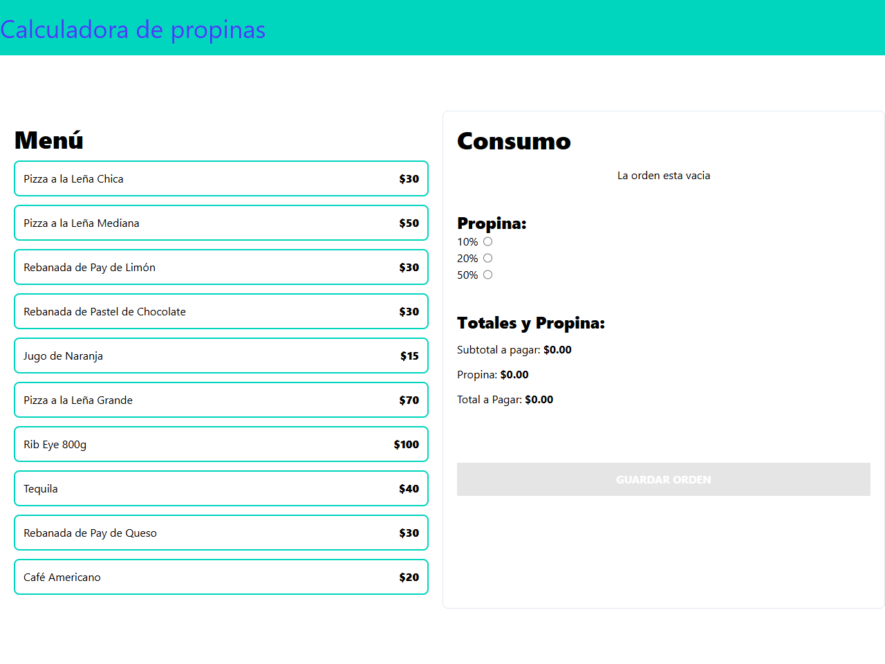
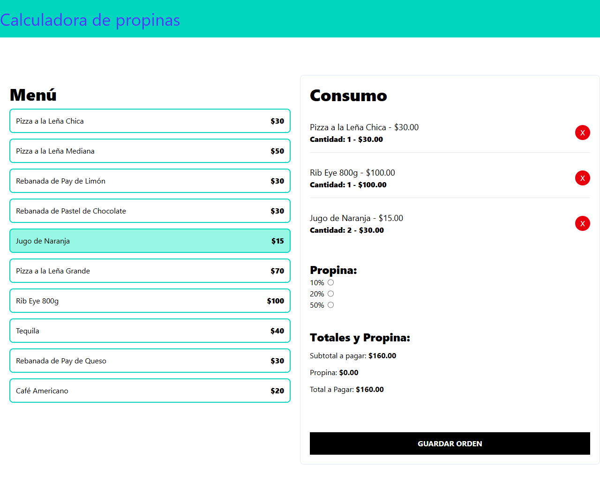
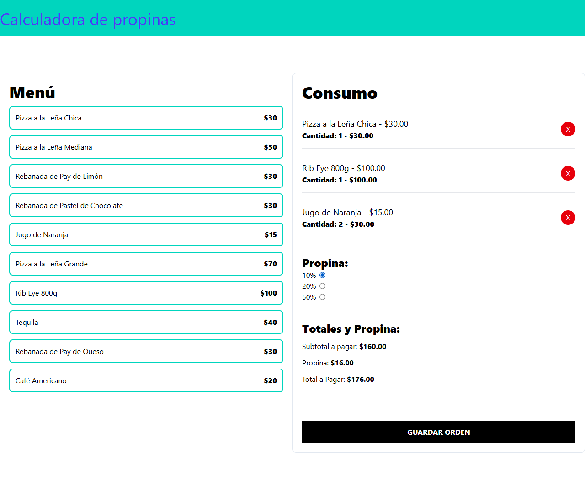
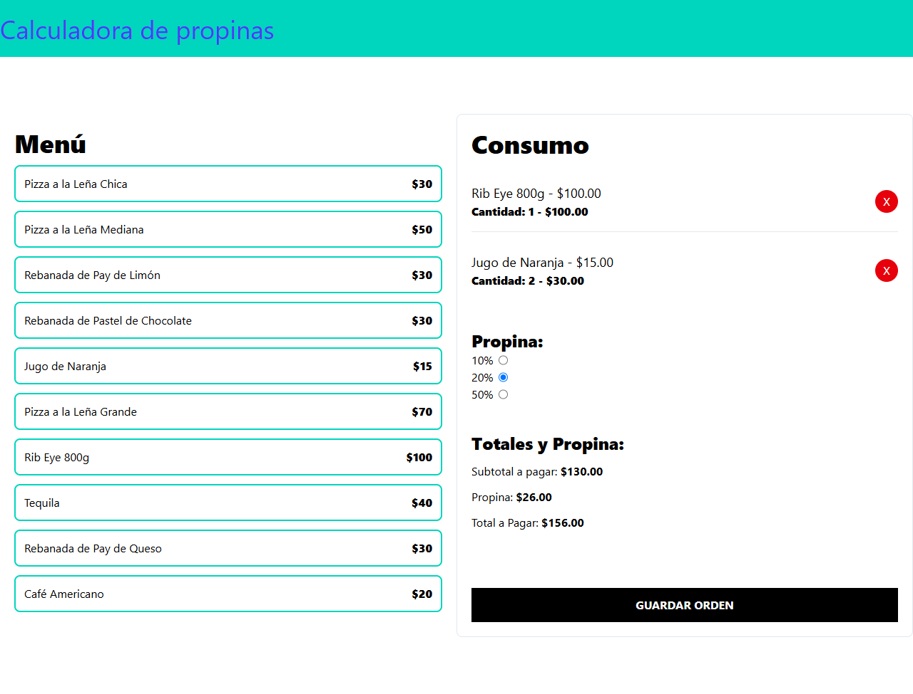
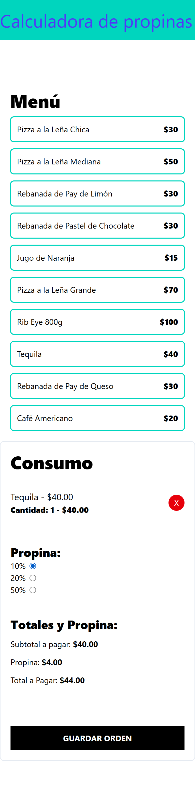

# Práctica Clase 13 | Calculadora de propinas con React

> Programación en Ambiente Web II (ISW-621) · Ingeniería del Software
> Universidad Técnica Nacional, Sede San Carlos

---

## Descripción

Aplicación web para calcular la cuenta y la propina de un restaurante, desarrollada como repaso de **React** con **TypeScript**. El usuario elige productos del menú, la orden se arma en tiempo real, se selecciona el porcentaje de propina y la aplicación calcula el subtotal, la propina y el total a pagar.

La práctica reúne los conceptos centrales de React:

- **Componentes** funcionales con props tipadas.
- **Estado** con `useState` dentro de un **hook personalizado** (`useOrder`).
- **Renderizado de listas** con `.map()` y `key`.
- **Renderizado condicional** para el estado de la orden vacía.
- **Valores derivados** con `useCallback` (subtotal, propina y total).
- **Tailwind CSS v4** para los estilos, sin hojas de CSS propias.

---

## Tecnologías


---

## Funcionalidades

- Menú de 10 productos con su precio.
- Agregar un producto a la orden con un clic; si ya existe, aumenta su cantidad.
- Eliminar un artículo de la orden con el botón rojo.
- Selección de propina de 10 %, 20 % o 50 %.
- Cálculo automático de subtotal, propina y total, con formato de moneda en dólares.
- Botón **Guardar orden** que reinicia la orden y la propina; se deshabilita cuando la orden está vacía.
- Diseño responsivo: dos columnas en escritorio y una sola en celular.

---

## Arquitectura de archivos

```
guitarra
 ┣ 📄 index.html
 ┣ 📄 vite.config.ts              Plugins de React y Tailwind
 ┣ 📄 package.json
 ┗ 📂 src
   ┣ 📄 main.tsx                  Punto de entrada: monta <App /> en el DOM
   ┣ 📄 App.tsx                   Compone las columnas y conecta el hook con los componentes
   ┣ 📄 index.css                 Importa Tailwind CSS
   ┣ 📂 componentes
   ┃ ┣ 📄 MenuItem.tsx            Botón de un producto del menú
   ┃ ┣ 📄 OrderContents.tsx       Lista de artículos de la orden
   ┃ ┣ 📄 TipPorcentageForm.tsx   Opciones de propina
   ┃ ┗ 📄 OrderTotals.tsx         Subtotal, propina, total y botón de guardar
   ┣ 📂 hooks
   ┃ ┗ 📄 useOrder.ts             Estado y lógica de la orden
   ┣ 📂 helpers
   ┃ ┗ 📄 index.ts                formatCurrency (formato de moneda)
   ┣ 📂 data
   ┃ ┗ 📄 db.ts                   Arreglo con los productos del menú
   ┗ 📂 types
     ┗ 📄 index.ts                Tipos MenuItem y OrderItem
```

### Responsabilidad de cada pieza

| Pieza | Archivo | Responsabilidad |
| --- | --- | --- |
| Hook | `hooks/useOrder.ts` | Guarda `order` y `tip`, y expone `addItem`, `removeItem`, `setTip` y `placeOrder`. |
| Componente | `MenuItem.tsx` | Muestra nombre y precio de un producto y llama a `addItem` al hacer clic. |
| Componente | `OrderContents.tsx` | Muestra los artículos con su cantidad y total, o el aviso de orden vacía. |
| Componente | `TipPorcentageForm.tsx` | Muestra los radios de propina y actualiza el estado con `setTip`. |
| Componente | `OrderTotals.tsx` | Calcula y muestra subtotal, propina y total; guarda la orden. |
| Helper | `helpers/index.ts` | Da formato de moneda con `Intl.NumberFormat`. |
| Tipos | `types/index.ts` | Define `MenuItem` y `OrderItem` (`MenuItem & { quantity }`). |
| Datos | `data/db.ts` | Contiene el menú, tipado como `MenuItem[]`. |

---

## Lógica del cálculo

```
subtotal = suma de (cantidad × precio) de cada artículo
propina  = subtotal × porcentaje de propina
total    = subtotal + propina
```

Ejemplo con la orden de las capturas (Pizza chica $30, Rib Eye $100 y 2 jugos de naranja $30) y 20 % de propina:

| Concepto | Valor |
| --- | --- |
| Subtotal | $160.00 |
| Propina (20 %) | $32.00 |
| **Total a pagar** | **$192.00** |

---

## Capturas

### Pantalla inicial

La orden aparece vacía y el botón de guardar está deshabilitado.



### Orden con artículos

Al repetir un producto aumenta su cantidad en lugar de duplicar la línea.



### Cálculo de propina

| Propina del 10 % | Propina del 20 % |
| --- | --- |
|  |  |

### Eliminar un artículo

Los totales se recalculan al quitar un producto.



### Versión móvil

El diseño se adapta a una sola columna en pantallas pequeñas.



---

## Buenas prácticas aplicadas

- **Separación de responsabilidades:** componentes de presentación, lógica en un hook, formato en un helper y datos en su propio módulo.
- **Tipado estricto:** props tipadas, `useState<OrderItem[]>` y funciones con firmas explícitas como `removeItem: (id: MenuItem['id']) => void`.
- **Estado inmutable:** las actualizaciones usan `map`, `filter` y el operador de propagación, sin mutar el arreglo.
- **Componentes controlados:** los radios de propina usan `checked`, por lo que se desmarcan al reiniciar la orden.
- **Accesibilidad:** cada opción de propina enlaza su `label` con su `input` mediante `htmlFor`.
- **Calidad de código:** el proyecto pasa `tsc` y ESLint sin errores.

---

## Ejecución

Requiere Node.js 20.19 o superior (o 22.12 o superior), según lo exige Vite 8.

```bash
cd clase13/guitarra
npm install
npm run dev
```

La aplicación queda disponible en `http://localhost:5173`.

| Comando | Acción |
| --- | --- |
| `npm run dev` | Servidor de desarrollo con recarga automática. |
| `npm run build` | Revisa los tipos y genera la versión de producción en `dist/`. |
| `npm run preview` | Sirve localmente la versión de producción. |
| `npm run lint` | Ejecuta ESLint sobre el proyecto. |

---

## Autor

**Wilberth Guillén Aguilar**
Estudiante de Ingeniería del Software, UTN Sede San Carlos
[@WGuillenDev](https://github.com/WGuillenDev)
