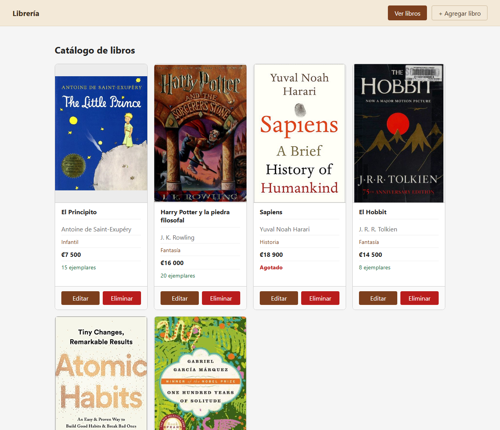

# Clase 14 | Sistema de Gestión de Inventario de Libros

> Programación en Ambiente Web II (ISW-621) · Ingeniería del Software
> Universidad Técnica Nacional, Sede San Carlos

---

## Descripción

Aplicación web full-stack desacoplada para administrar el catálogo de una librería. Permite **listar, agregar, editar y eliminar** libros, con los datos guardados en **PostgreSQL**.

- **Backend:** API REST con Express 5 y patrón **MVC** (modelo, controlador y rutas).
- **Frontend:** interfaz reactiva con **React** y componentes, que consume la API con Axios.
- **Base de datos:** `libreria_db`, tabla `libros`.

---

## Tecnologías


---

## Base de datos

| Columna | Tipo | Restricciones |
| --- | --- | --- |
| `id` | `SERIAL` | Clave primaria |
| `titulo` | `VARCHAR(150)` | `NOT NULL` |
| `autor` | `VARCHAR(100)` | `NOT NULL` |
| `genero` | `VARCHAR(50)` | `NOT NULL` |
| `precio` | `NUMERIC(10, 2)` | `NOT NULL` |
| `ejemplares` | `INTEGER` | `NOT NULL DEFAULT 0` |
| `portada_url` | `TEXT` | Opcional (`NULL`) |

---

## Arquitectura

```
clase14
 ┣ 📂 database
 ┃ ┣ 📄 00-create-database.sql     Crea libreria_db
 ┃ ┗ 📄 01-schema.sql              Crea la tabla libros
 ┣ 📂 backend-libreria               API (puerto 4000)
 ┃ ┗ 📂 src
 ┃   ┣ 📄 server.ts                Arranque de Express y montaje de rutas
 ┃   ┣ 📂 config                   Conexión a PostgreSQL (pool)
 ┃   ┣ 📂 models                   Consultas SQL (libroModel.ts)
 ┃   ┣ 📂 controllers              Validación y respuestas HTTP (libroController.ts)
 ┃   ┣ 📂 routes                   Rutas de /api/libros
 ┃   ┗ 📂 types                    Interfaz Libro
 ┗ 📂 frontend-libreria              Interfaz (puerto 5173)
   ┗ 📂 src
     ┣ 📄 App.tsx                  Vista activa: lista, crear o editar
     ┣ 📂 api                      Cliente Axios y funciones por operación
     ┣ 📂 components               LibroList y LibroForm
     ┗ 📂 types                    Interfaces Libro y NuevoLibro
```

| Capa | Responsabilidad |
| --- | --- |
| Modelo | Único lugar con SQL, con consultas parametrizadas (`$1, $2...`). |
| Controlador | Valida los datos, llama al modelo y responde con el código HTTP adecuado. |
| Rutas | Conecta cada verbo y URL con su función del controlador. |
| Componentes | `LibroList` muestra y elimina; `LibroForm` crea y edita. |

---

## API

| Método | Ruta | Acción | Respuesta |
| --- | --- | --- | --- |
| GET | `/api/libros` | Lista los libros | 200 |
| POST | `/api/libros` | Crea un libro | 201 / 400 |
| PUT | `/api/libros/:id` | Edita un libro | 200 / 400 / 404 |
| DELETE | `/api/libros/:id` | Elimina un libro | 200 / 404 |

---

## Captura



---

## Ejecución

Requiere Node.js 20.19 o superior y PostgreSQL.

1. Instala las dependencias:

   ```bash
   npm ci
   ```

2. Crea la base de datos: ejecuta `database/00-create-database.sql` en pgAdmin y luego `database/01-schema.sql` conectado a `libreria_db`.

3. Copia `backend-libreria/.env.example` a `backend-libreria/.env` y escribe la contraseña de tu servidor en `DB_PASSWORD`.

4. Inicia ambos proyectos:

   ```bash
   npm run dev
   ```

La interfaz queda en `http://localhost:5173` y la API en `http://localhost:4000/api/libros`.

Otros comandos: `npm run check` (tipos) y `npm run build` (compilar).

---

## Créditos

Portadas de ejemplo de [Open Library](https://openlibrary.org/).

---

## Autor

**Wilberth Guillén Aguilar**
Estudiante de Ingeniería del Software, UTN Sede San Carlos
[@WGuillenDev](https://github.com/WGuillenDev)
