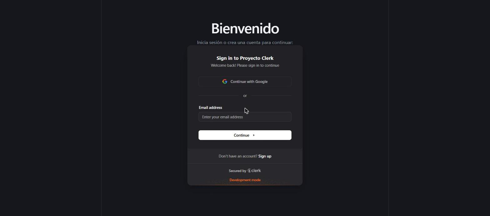
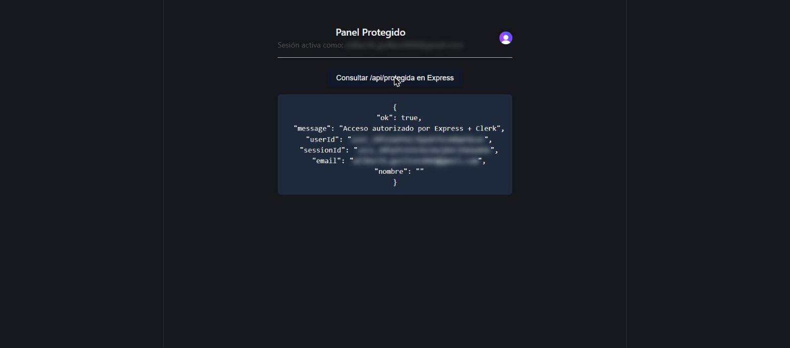

# Clase 16 | Autenticación de Usuarios con Clerk

> Programación en Ambiente Web II (ISW-621) · Ingeniería del Software
> Universidad Técnica Nacional, Sede San Carlos

---

## Descripción

Aplicación web full-stack desacoplada que delega la autenticación en **Clerk** (Auth-as-a-Service). Permite **registrarse, iniciar sesión, administrar la cuenta y cerrar sesión**, y consultar una ruta protegida de la API con el token de la sesión.

- **Backend:** API en Express 5 que verifica el token JWT con `@clerk/express`.
- **Frontend:** interfaz con **React** y los componentes preconstruidos de Clerk (`<SignIn />` y `<UserButton />`).
- **Usuarios:** los almacena y administra Clerk; el proyecto no usa base de datos propia.

---

## Tecnologías


---

## Versión del SDK

El frontend usa `@clerk/react` en lugar de `@clerk/clerk-react`, porque Clerk rechaza el inicio de sesión con el paquete anterior en esta aplicación. Por el mismo cambio, `<SignedIn>` y `<SignedOut>` se reemplazan por `<Show>`.

---

## Variables de entorno

| Archivo | Variable | Valor |
| --- | --- | --- |
| `backend/.env` | `PORT` | `3005` |
| `backend/.env` | `CLIENT_ORIGIN` | `http://localhost:5173` |
| `backend/.env` | `CLERK_PUBLISHABLE_KEY` | Llave pública (`pk_test_...`) |
| `backend/.env` | `CLERK_SECRET_KEY` | Llave secreta (`sk_test_...`) |
| `frontend/.env` | `VITE_CLERK_PUBLISHABLE_KEY` | La misma llave pública |

Los archivos `.env` no se suben al repositorio.

---

## Arquitectura

```
clase16
 ┗ 📂 proyecto-clerk
   ┣ 📂 backend                  API (puerto 3005)
   ┃ ┣ 📂 src
   ┃ ┃ ┗ 📄 server.ts            Express, CORS, middleware de Clerk y rutas
   ┃ ┣ 📄 .env.example           Plantilla de variables de entorno
   ┃ ┣ 📄 package.json
   ┃ ┗ 📄 tsconfig.json
   ┗ 📂 frontend                 Interfaz (puerto 5173)
     ┣ 📂 src
     ┃ ┣ 📄 App.tsx              Inicio de sesión y panel protegido
     ┃ ┗ 📄 main.tsx             Envuelve la app con ClerkProvider
     ┣ 📄 .env.example           Plantilla de la llave pública
     ┗ 📄 package.json
```

| Pieza | Responsabilidad |
| --- | --- |
| `ClerkProvider` | Da acceso a la sesión de Clerk a toda la aplicación. |
| `Show when="signed-out"` y `SignIn` | Muestran el formulario de acceso cuando no hay sesión. |
| `Show when="signed-in"` y `UserButton` | Muestran el panel y el menú de la cuenta cuando hay sesión. |
| `getToken` | Entrega el token que se envía en el encabezado `Authorization: Bearer`. |
| `clerkMiddleware` | Lee y verifica el token en cada petición. |
| `getAuth` | Indica quién hace la petición; sin usuario se responde 401. |

---

## API

| Método | Ruta | Acción | Respuesta |
| --- | --- | --- | --- |
| GET | `/api/public` | Consulta abierta, sin autenticación | 200 |
| GET | `/api/protegida` | Devuelve usuario, sesión, correo y nombre | 200 / 401 |

---

## Capturas





---

## Ejecución

Requiere Node.js 20.19 o superior y una cuenta de [Clerk](https://clerk.com/).

1. En el panel de Clerk, crea una aplicación, activa los métodos de acceso (por ejemplo, correo con contraseña y Google) y copia las llaves desde **API Keys**.

2. Copia `proyecto-clerk/backend/.env.example` a `.env` en la misma carpeta y escribe las dos llaves. Haz lo mismo en `proyecto-clerk/frontend` con la llave pública.

3. En una terminal, inicia el backend:

   ```bash
   cd proyecto-clerk/backend
   npm install
   npm run dev
   ```

4. En otra terminal, inicia el frontend:

   ```bash
   cd proyecto-clerk/frontend
   npm install
   npm run dev
   ```

5. Abre `http://localhost:5173`, regístrate o inicia sesión y pulsa **Consultar /api/protegida en Express**.

La API queda en `http://localhost:3005/api/public`.

Otros comandos: `npm run build` (compilar, en ambas carpetas).

---

## Autor

**Wilberth Guillén Aguilar**
Estudiante de Ingeniería del Software, UTN Sede San Carlos
[@WGuillenDev](https://github.com/WGuillenDev)
